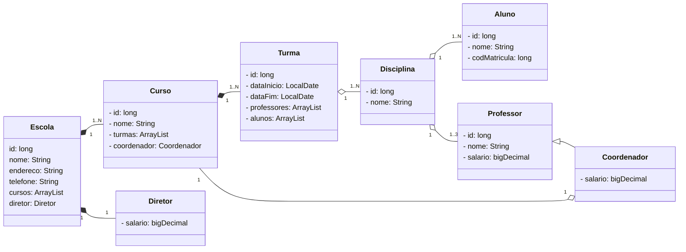
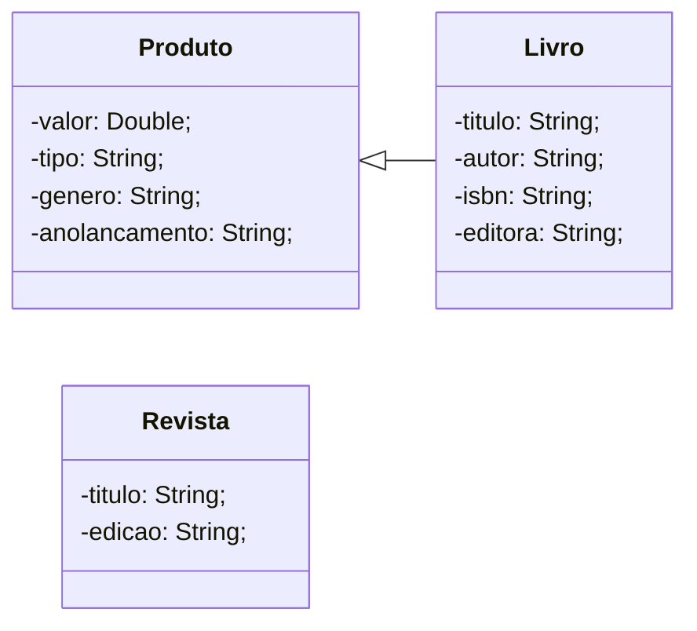

# Modelagem UML

Para cada um dos exercícios abaixo, crie um diagrama UML com associações de herança.

- Você pode criar as classes que julgar necessário.
- Cada classe deve ter pelo menos um atributo e um método

É necessário pensar em um contexto de domínio para o problema. Exemplos: Escola, biblioteca, transporte, zoológico.

## Escola: Aluno professor, coordenador, diretor



## Livro, revista, jornal, gibi



## Carro, avião, barco, caminhão

```mermaid
        
```

## Gato, cachorro, arara, galinha, baleia, tubarão

```mermaid
        
```